# NeuroFiLM: Text-Guided Brain Tumor Segmentation on Apple Silicon

**A lightweight FiLM-conditioned U-Net that fuses FLAIR MRI with radiology reports (CLIP) on BraTS 2020, trained entirely on a MacBook Pro (M1 Pro, MPS backend).**

[](https://pytorch.org/)
[](#-built-for-apple-silicon-mps)
[](#architecture)
[](#results)


---

## TL;DR

| | |
|---|---|
| **Task** | Binary (whole-tumor) segmentation of glioma in 2-D axial slices |
| **Image input** | **FLAIR only**, 1 × 128 × 128 |
| **Text input** | One radiology report per patient (Text BraTS), frozen CLIP ViT-B/32 → 512-D |
| **Model** | U-Net + FiLM at the bottleneck and 4 decoder stages — **8.78 M parameters**, only 17.9 k of them for text conditioning |
| **Result** | **Dice 0.855**, precision 0.937, 82 % of test slices with Dice > 0.8 |
| **Hardware** | MacBook Pro M1 Pro, 16 GB unified memory, PyTorch **MPS**, no CUDA |
| **Main takeaway** | A small single-modality 2-D model gets competitive whole-tumor overlap; the limits (enhancing tumor, 3-D context, resolution, text granularity) are understood and documented below |

This is deliberately **not** a full multi-modal BraTS pipeline. It is a study in how far a small, single-modality, laptop-trainable model can go, plus an ablation of whether report text helps.

---

## Pipeline at a glance

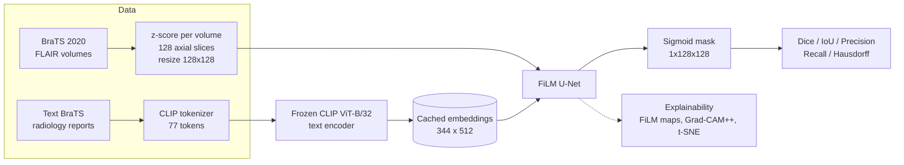

CLIP is run **once**, on CPU, and its embeddings are cached. That keeps the 63 M-parameter text transformer out of the training loop, which is what makes laptop training feasible.

---

## Architecture

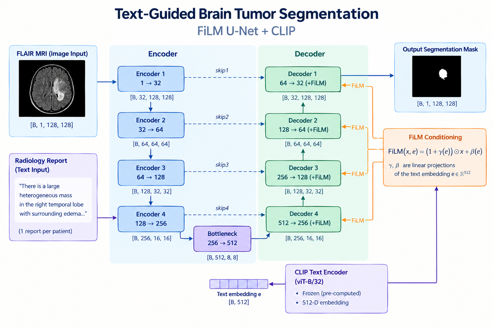

*In the diagram, the report arrow points at Encoder 4 for layout reasons. In the model the text embedding does not enter the encoder: it only drives the FiLM layers at the bottleneck and the four decoder stages (the bottleneck's FiLM is not drawn).*

The same structure as a flowchart:

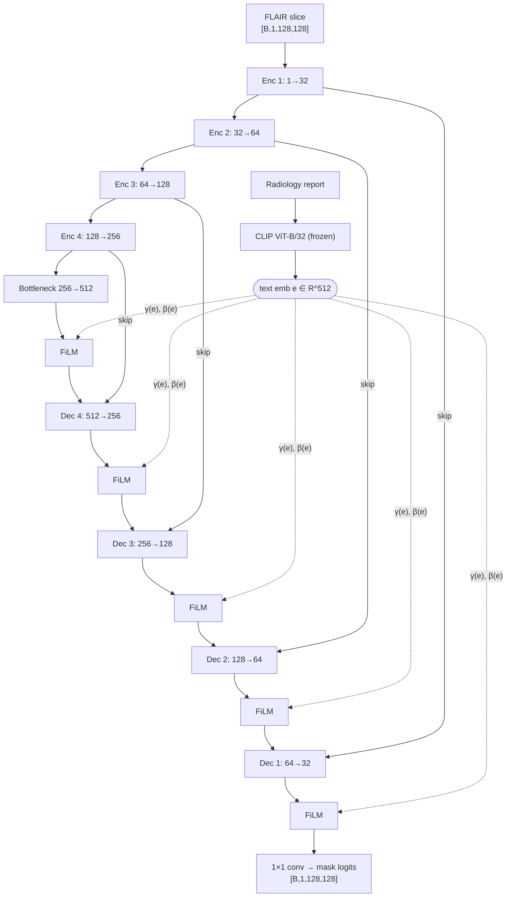

**FiLM** applies a learned per-channel affine transform driven by the report embedding:

```
FiLM(x, e) = (1 + γ(e)) ⊙ x + β(e)        γ, β = Linear(512 → C), zero-initialised
```

Zero initialisation makes every FiLM layer an identity at step 0, so the text pathway has to *earn* its effect through gradient descent.

**Ablation design.** The image-only baseline is the *same network* with `e = 0` (FiLM becomes identity). Same architecture, loss, optimizer, seed, so any difference is attributable to text.

**Loss:** `0.5·Dice + 0.3·BCE + 0.2·Focal(α=0.25, γ=2)`, all implemented from scratch.

---

## Results

Held-out test set: 56 patients, **5,504 slices** (patient-level split, seed 42, no leakage). Numbers are from the evaluation cell of the notebook.

| Metric | Multimodal (FiLM + CLIP) | Image-only (e = 0) |
|---|---|---|
| Dice | 0.8554 ± 0.269 | 0.8556 ± 0.272 |
| IoU | 0.8130 ± 0.284 | 0.8144 ± 0.286 |
| **Precision** | **0.9365 ± 0.158** | 0.9256 ± 0.186 |
| Recall | 0.8632 ± 0.264 | **0.8740 ± 0.250** |
| Hausdorff (px @128²) | 6.35 ± 10.5 | **6.10 ± 10.1** |
| Slices with Dice > 0.8 | 82.2 % | 82.3 % |
| Best val Dice (epoch) | 0.8242 (21) | 0.8367 (33) |

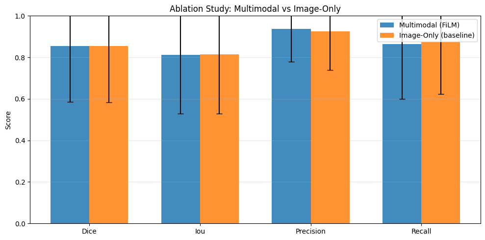

**How to read this honestly:** the two models are tied on Dice. Text conditioning shifts the *precision/recall trade-off* (+1.1 pp precision, −1.1 pp recall) rather than overlap. On tumor-containing slices only, the report gives Dice 0.840 (multimodal) vs 0.826 (image-only), with Cohen's d ≈ −0.19 on the paired per-slice comparison, i.e. a negligible effect size. The text signal works, but it is weak with this design (see [why](#why-text-helps-so-little)).


### Training dynamics

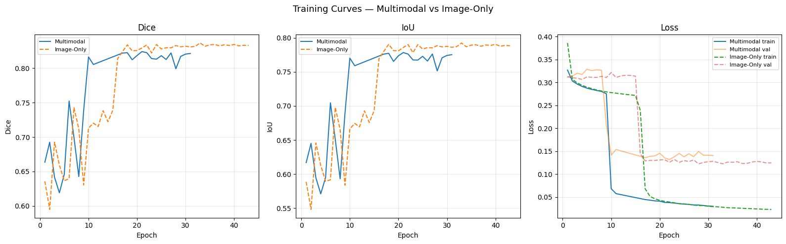

The multimodal run early-stopped at epoch 21 (best val), the image-only at epoch 33. Both show a late drop in loss that suggests the LR schedule/optimizer phase matters more than the text pathway.

### Qualitative segmentation (green = ground truth, red = prediction, yellow = overlap)

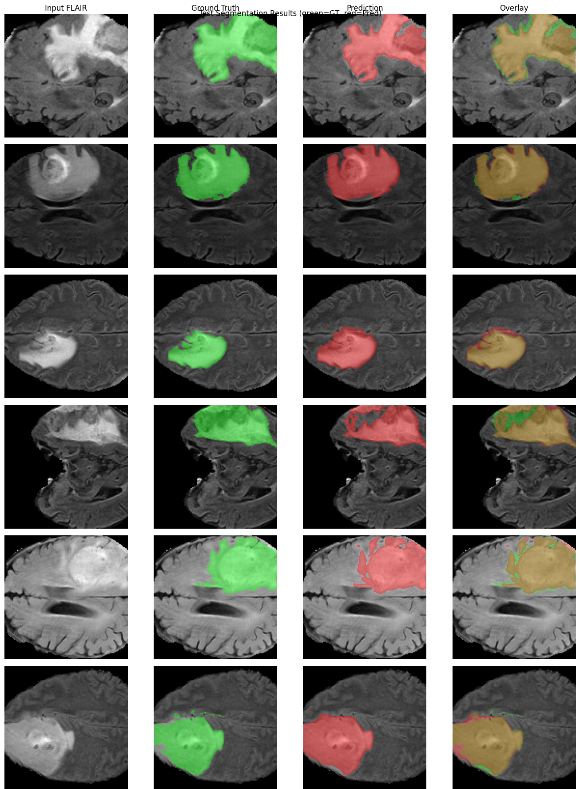

### Per-slice Dice distribution and failures

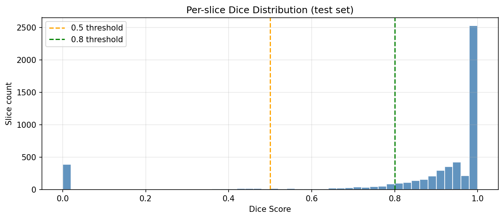

The distribution is bimodal: a large mass near 1.0 (well-segmented slices and correctly empty slices) and a spike at 0 (about 380 slices), which are mostly blank or tiny-mask slices where any false positive scores Dice 0. Failure cases cluster on small or diffuse tumors and the superior/inferior boundary slices.

---

## Why enhancing-tumor performance is expected to be weak (modality limitation)

BraTS annotates three nested sub-regions: **edema (ED)**, **necrotic/non-enhancing core (NCR/NET)** and **enhancing tumor (ET)**. Clinically reported scores are Whole Tumor (WT = all three), Tumor Core (TC = NCR + ET) and Enhancing Tumor (ET).

This project uses **one modality (FLAIR)** and **collapses every label to a single binary class**. That has a direct consequence for ET:

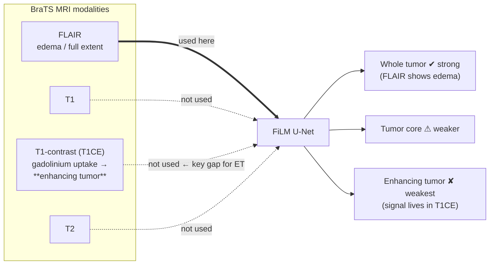

- **FLAIR highlights edema** and therefore the whole tumor extent. That is why whole-tumor Dice is high.
- **Enhancing tumor is defined by contrast uptake**, which is visible on **T1CE**, not on FLAIR. A FLAIR-only network has little direct evidence for the thin, bright enhancing rim.
- It is also tiny: at 128 × 128 the rim is only ~1–3 pixels wide, so resizing from 240 × 240 hurts it disproportionately.
- A binary whole-tumor Dice is dominated by edema volume, so ET errors barely move the headline number.

> **Important scope note.** The code binarises the labels (`{1,2,4} → 1`) and evaluates a single class, so **per-region WT/TC/ET Dice were never computed in this project.** The statement above is a reasoned explanation of the expected ET gap, not a measured result. Measuring it is the first item in the roadmap (needs T1CE as an input channel plus a 3-class head, evaluated with WT/TC/ET).

---

## Why text helps so little

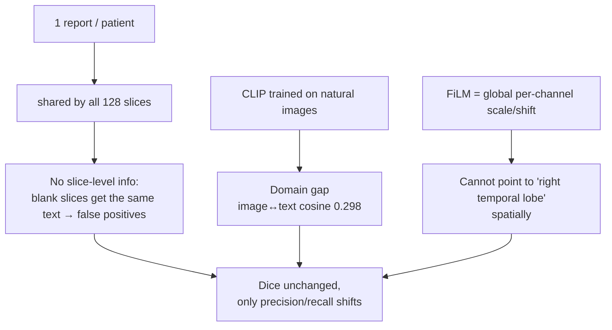

The t-SNE of CLIP image vs. report embeddings shows two largely **separate clusters** with long same-patient links — consistent with the modest 0.298 cosine similarity: partial, not strong, alignment.


---

## Explainability

Grad-CAM++ on the final decoder block (`d1`, 128 × 128), which has full output resolution (encoder `e4` is only 16 × 16 and smears after upsampling). Right column: multimodal minus image-only attention.

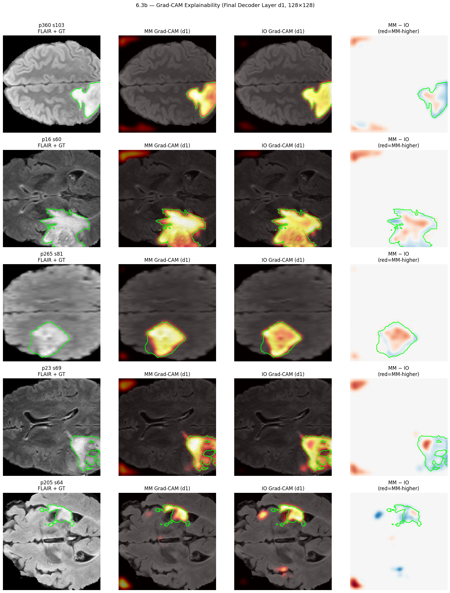


---

## 🍎 Built for Apple Silicon (MPS)

The whole project was developed and trained on a **MacBook Pro, Apple M1 Pro, 16 GB unified memory**, with no CUDA GPU. Design choices were made around that constraint:

| Setting | Value | Why |
|---|---|---|
| Device | `mps` (fallback `cuda` → `cpu`) | Apple GPU through Metal Performance Shaders |
| Batch size | 8 | CPU and GPU **share** 16 GB; larger batches caused memory pressure |
| Mixed precision / GradScaler | **Disabled** | Not supported on MPS in the PyTorch version used |
| DataParallel | Disabled | Single unified GPU |
| `num_workers` | 0 | Avoids macOS fork/multiprocessing issues with the MPS context |
| `pin_memory` | False | Pointless with unified memory |
| CLIP inference | **CPU, one-time** | Some CLIP attention ops were not reliably supported on MPS; embeddings cached to disk |
| Data loading | All slices pre-loaded into RAM (~5–6 GB) | Disk I/O was the bottleneck on MPS |
| Training time | ≈ 8–12 min/epoch (per notebook notes) | 50 epochs max, early stopping patience 10 |
| Environment | PyTorch 2.11, MPS built & available | From the notebook's own output |

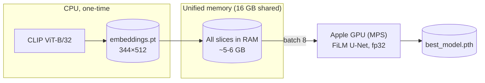

Take-away for a laptop: **pre-compute the frozen foundation-model features, keep the trainable model small (8.8 M), and hold the dataset in unified memory.**

---

## Interactive demo

A Gradio app (`demo.py`, served at `localhost:7860`) loads both checkpoints and offers Single Model, Model Comparison and About tabs; with a ground-truth mask it shows live Dice/IoU/Precision/Recall. *(`demo.py` and the checkpoints are not in this folder — only the screenshot below.)*

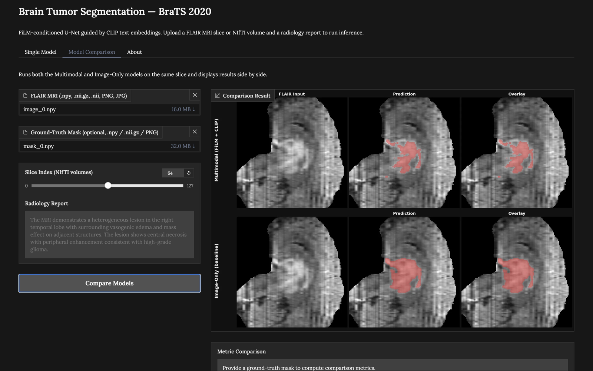

---

## Roadmap

| # | Improvement | Targets |
|---|---|---|
| 1 | **Add T1CE (ideally all 4 modalities) + 3-class head; report WT/TC/ET** | Enhancing-tumor gap |
| 2 | Slice-aware text conditioning (per-slice tumor-presence gate, "no pathology" token) | Blank-slice false positives |
| 3 | Medical text encoder (BioViL-T) or contrastive fine-tuning of the CLIP projection | CLIP domain gap |
| 4 | Token-level cross-attention at the bottleneck | Spatial grounding of report text |
| 5 | Native 240 × 240 resolution | Thin boundaries, Hausdorff |
| 6 | 2.5-D / 3-D backbone | Boundary-slice failures |

---

## Repository layout

```
neurofilm-brats/
├── README.md
├── requirements.txt
├── DL Project Code CS23B2007 (1).ipynb      original notebook
├── DL_Project_Report_CS23B2007 (1).pdf      paper
├── DL_Project_Slides_CS23B2007.pdf          slides
├── src/                                     notebook split into ordered stages
│   ├── 01_setup_environment.py              MPS device, seeds, paths
│   ├── 02-03_*.py                           dataset validation, patient-level split, preview
│   ├── 04_clip_text_embeddings.py           frozen CLIP, cached once on CPU
│   ├── 05_load_slices_into_ram.py
│   ├── 06_model_film_unet.py                FiLM U-Net
│   ├── 07-08_train_*.py                     multimodal and image-only training
│   ├── 09_evaluate_test_set.py
│   ├── 10-13_*.py                           curves, segmentation grid, ablation, error analysis
│   ├── 14-17_*.py                           FiLM maps, t-SNE, text metrics, Grad-CAM++
│   ├── 18-19_*.py                           Wilcoxon test, precision/recall trade-off
│   ├── 20_output_inventory.py
│   └── run_all.py                           runs the stages in one shared namespace
└── figures/                                 all graphs and screenshots used in this README
```

## Reproducing

1. Place data as `dataset/FLAIR_BRATS2020_split/{train,val}/{images,masks}/*.npy` and `dataset/TextBRats/TextBraTSData/BraTS20_Training_XXX/*_flair_text.txt`.
2. `pip install -r requirements.txt`
3. On an Apple Silicon Mac, run `python src/run_all.py`, or run the stages one by one. `src/` is the notebook extracted verbatim and the stages share variables, so use `run_all.py` and include earlier stages when picking a subset, e.g. `python src/run_all.py 01 02 03 04 05 06 07`. Set `EPOCHS = 20` in stages 07 and 08 for a quick trial.
4. Stages 02, 03 and 05 import `data_loader_utils.py` and `01_explore_dataset.py`. Those two files were not in the folder I received, so the data-loading stages will not run until they are added.

> Paths in the scripts still point to the original machine (`~/Desktop/Deep Learninf Final Project/...`) and to a Kaggle mirror; adjust them. The scripts have been syntax-checked but not executed, since the dataset and checkpoints are not here.

---

## Known inconsistencies in the source material

Worth knowing before this goes public:

- **Slices per volume:** the notebook and slides use **128** slices/patient (33,024 / 5,504 / 5,504); the paper's Table I says 155 (39,990 / 8,525 / 8,680). This README follows the notebook.
- **Paper Table V "all slices"** (Dice 0.804 MM vs 0.862 IO) contradicts the paper's abstract and the notebook's evaluation output (0.8554 vs 0.8556). This README uses the notebook outputs.
- The paper describes the t-SNE as "interleaved"; the figure shows largely separated clusters.
- The per-slice precision-advantage histogram in the notebook (`19_precision_recall_tradeoff.py`) shows a mean MM minus IO difference of about -0.056, which does not match the +1.1 pp precision gain in the aggregate numbers. The cause isn't documented in the notebook (it comes from `results_table.csv`), so check it before quoting the +1.1 pp figure.
- Text coverage: 344 patients have images and reports; 25 patients fall back to a placeholder report.

## References

U-Net (Ronneberger 2015) · FiLM (Perez 2018) · CLIP (Radford 2021) · BraTS (Menze 2015; Bakas 2018) · nnU-Net (Isensee 2021) · BioViL-T (Bannur 2023) · Focal loss (Lin 2017) · Grad-CAM (Selvaraju 2017). Full list in the report PDF.
# neurofilm-brats
